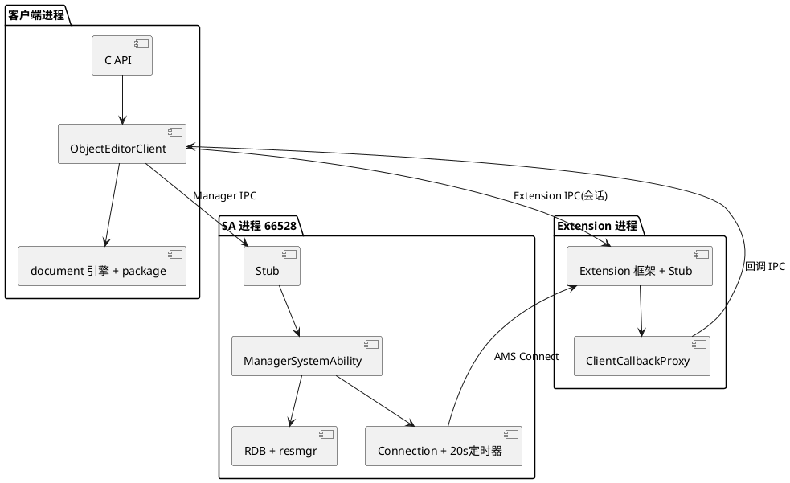

# 架构设计及约束

目录均从仓根解析；行为定义见[业务背景](business-context.md)，术语见[术语表](glossary.md)。

## 架构设计

### 设计原则

| 原则 | 描述 | 理由 |
|---|---|---|
| 控制面与数据面分离 | SA 只做注册、路由、拉起、回收；会话建立后客户端直连 Extension 通道 | SA 不成为大流量中继；Extension 崩溃不拖垮 SA |
| 注册数据与运行数据分离 | BMS→RDB 注册库（oeid→应用）；运行会话在 `connectionMap_`（remoteObject→connection） | 注册随包生命周期，会话随 IPC 生命周期，两者清理时机不同 |
| 路由策略逐级兜底 | 默认应用 → 最新注册 → diversion 改道 → 通用包（PACKAGE_OEID） | 任何格式都有可用行为：编辑不了也能以图标嵌入并唤起默认应用 |
| 按需启动、分层退出 | `bindercall` 拉起进程；Extension 20s 空闲停用、SA 600s 空闲自卸载、死亡监听即时回收 | 常驻成本最小化；三层回收覆盖正常、异常、静默三种退出 |
| 元数据走 IPC、内容走文件 | 跨进程序列化只传 8 字段文档元数据与 URI；快照 PNG、复合文件本体走 URI 授权文件 | binder parcel 不适合大块二进制；文件通道天然支持增量与离线 |
| 引擎与业务解耦 | `document/` 是通用 MS-CFB 引擎；`package/` 只实现 Ole10Native 兜底；业务语义全部由应用回调承载 | 引擎可独立测试（8 个测试套），格式兼容问题不扩散到业务层 |
| fail-closed 准入 | DLP 查询失败视为在沙箱；权限、限流、调用方校验全部前置拒绝 | 宁可拒绝服务不可越权 |

### 逻辑架构

| 层/模块 | 源码目录 | 职责与关键对象 |
|---|---|---|
| NDK（对外 C API） | `frameworks/ndk/src` | `object_editor_proxy_capi.cpp`、`object_editor_document_capi.cpp`、`object_editor_extension_capi.cpp`、错误码映射 `object_editor_native_common.cpp`；C 对象定义 `frameworks/ndk/include/native_object_editor_types.h` |
| 客户端库 | `client/src` | `ObjectEditorClient`（单例：SA 代理缓存、回调注册表、临时文件）、`ObjectEditorManagerProxy`（9 命令 IPC）、`ObjectEditorClientCallback(Stub)`（4 命令回调分发）、`ObjectEditorExtensionDeathRecipient`、`ObjectEditorSADeathRecipient` |
| Extension 运行时 | `frameworks/kits/extension/src` | `ObjectEditorExtension`（`ExtensionBase + ObjectEditorExtensionStub` 双继承）、`ObjectEditorExtensionContext`、`ObjectEditorExtensionModuleLoader`（type 511，dlopen 入口） |
| Extension IPC 骨架 | `extension_ability/src` | `ObjectEditorExtensionStub`（进程内收 7 命令）、`ObjectEditorClientCallbackProxy`（反调客户端）——无自有 GN 目标，编入 `content_embed_extension` |
| 文档引擎 | `document/src` | `StorageIO`（CFB 引擎，文件/内存双模式）、`Storage`/`Stream`（POLE 风格门面）、`DirTree`/`DirEntry`、`AllocTable`、`Header`、`ObjectEditorDocument`（Parcelable） |
| 通用包兜底 | `package/src` | `ObjectEditorPackage`（客户端进程内 `IObjectEditorService` 本地实现）、`PackageData`（Ole10Native 解析/生成）、`FileWatcher`（inotify）——编入 `content_embed_client` |
| 系统服务 | `system_ability/src` | `ObjectEditorManagerSystemAbility`（SA 主体：路由、连接池、限流、空闲退出、diversion）、`ObjectEditorManagerStub`（8 case 分发）、`ObjectEditorConnection`（AMS 连接 + 20s 定时器）、`ObjectEditorClientDeathRecipient` |
| 注册库 | `database/src` | `ObjectEditorManagerDatabase`（RDB，BMS 事件订阅）、`ObjectEditorManagerResmgr`（locale 资源还原）、`ObjectEditorManagerUtils`（`content_embed_config` 解析） |
| 公共 | `common/src` | `ObjectEditorConfig`（DLP/系统参数，fail-closed）、`UserMgr`（当前用户）、`SystemUtils`（路径规范化/后缀/URI）、`ObjectEditorExtensionProxy`（SA→Extension IPC）、`ObjectEditorFormat` |
| 工具 | `utils/src` | `ObjectEditorPermissionUtils`（权限校验）、`ObjectEditorBmsUtils`、`ObjectEditorEventManager` + 屏幕事件接收器、HiLog 封装（域 `0xD005118`） |
| 接口 | `interfaces/` | `kits/c/`（NDK 公共头，`@since 24`）；`innerkits/include/`（三条 IPC 通道接口与命令枚举、错误码、常量；无 GN 目标，纯头文件被 5 处 BUILD.gn 引用） |
| 配置 | `sa_profile/`、`etc/` | `66528.json`（SA profile）、`object_editor_service.cfg`（init job + 权限）、`diversion_map.json`（OLE 改道表） |

注意：`interfaces/innerkits` 的部分头（如 `object_editor_common.h`）反向 include 公共头 `content_embed_common.h`；且 `client/BUILD.gn` 与 `frameworks/ndk/BUILD.gn` 会重复编译同一批 cpp（`object_editor_config.cpp` 带/不带 `WITH_DLP` 各一份），同名符号在进程内可能存在两份实现。

### 启动链与关键流程

按需启动：客户端 `ObjectEditorClient::GetIObjectEditorManager`（`client/src/object_editor_client.cpp`）先 `SubscribeSystemAbility(66528)`，`CheckSystemAbility` 未命中则 `LoadSystemAbility` + 条件变量等待（上限 5s）→ init 按 `bindercall` 拉起 `object_editor_service` → `sa_main` dlopen `libcontent_embed_service.z.so` → 构造函数完成 diversion 加载、`ObjectEditorManagerDatabase::Init`（建库 + BMS 订阅）、屏幕事件订阅 → `OnStart` 起停止原因清理线程并 `Publish`。**数据库初始化在构造期而非 OnStart**——首个 binder call 到达时注册库必须已可用。

会话链（StartWork）：`PrepareFiles`（沙箱临时目录 + 源文件拷贝/链接 + 空 snapshot + ole.bin）→ Manager IPC（document + 回调 binder）→ SA：权限/限流/DLP 前置 → 格式路由（默认应用→最新注册→diversion→PACKAGE）→ `GrantUriPermission`（客户端 URI → 目标 bundle 读写）→ `ConnectAbilityWithIndirectCallerInfo`（携带间接调用方身份）→ `OnAbilityConnectDone` → `Initial(document, clientCb, callerTokenId)` 传给 Extension → Extension 建 `ContentEmbed_Object` 并触发应用 `onObjectAttachFunc` → 客户端挂 Extension 死亡监听。Extension 侧 `Initial` 强校验调用方 `uid==OESA_UID(7061)`。

编辑与快照：客户端 `DoEdit(documentId)` 直连 Extension → `onDoEditFunc` → 应用经 `ObjectEditorExtensionContext::StartAbility` 反向走 SA 的 `StartUIAbility`（want 的 bundleName 必须等于调用方 bundle）拉起 UIAbility；快照由应用 `SetSnapshot` 写 PNG 到授权路径，客户端 `GetSnapshot` 解码。

回收链：正常停止 `StopWork` → SA `Close` → `DisconnectAbility`；异常：客户端死亡由 `ObjectEditorClientDeathRecipient` 触发 Stop；Extension 死亡由客户端死亡监听查停止原因（`SA_CLEAN_IDLE` 静默）后回调 `OnError`；空闲：每连接 20s 定时器（锁屏容忍一轮）探测编辑状态后停用；SA 自身 600s 无 IPC 且无连接则 `UnloadSystemAbility`。

### 非功能设计

| 场景类别 | 方案设计 |
|---|---|
| 并发一致性 | SA 静态锁族（`connectionMapMutex_`、`extensionStopReasonMapMutex_`、`diversionMapMutex_` 为 shared_mutex）；客户端 `callbackMutex_` 保护回调注册表，**用户回调在锁外执行**；`ObjectEditorDocument::docMutex_`（recursive）先拷贝 `shared_ptr<Storage>` 再锁外 I/O |
| 线程模型 | 全仓 `std::thread`（无 FFRT）：SA 停止原因清理线程（join）、SA 空闲定时器（**detach**）、每连接 20s 定时器（join）；NDK 无自建线程，回调在 binder 工作线程同步执行 |
| 异步资源回收 | 三层回收 + `DispatchFlagGuard`/`isStopping_`/`weak_ptr::expired()` 预检 + self-sptr 防自毁；停止原因登记 60s 窗口后清理 |
| 安全 | fail-closed DLP；每命令 `CONNECT_OBJECTEDITOR_EXTENSION` 权限 + 50 req/s 限流 + 连接上限（跨 bundle 2 个）；Extension 侧 `OESA_UID`/callerTokenId 双校验；`ValidateAndNormalizePath` 防沙箱逃逸；`IsValidFileExt` 防 SQL LIKE 注入 |
| 观测 | HiSysEvent（CREATE_DOCUMENT/REGISTER_EXTENSION/EDIT_DOCUMENT）、HiTrace、HiLog 域 `0xD005118` 分模块 tag |
| 兼容 | diversion 表把 Windows OLE CLSID 改道到本地 OEID，兼容带 OLE 数据的 Windows 文档回传；CFB v3/v4 双版本读写 |
| 构建 | 生产库默认 `pac_ret` + CFI/cfi_cross_dso；`WITH_DLP`、`IS_EMULATOR` 条件编译；coverage 默认关 |

### 构建与测试

构建从 OpenHarmony 源码树根进入（本仓无 build.sh；须检出在 `foundation/officeservice/object_editor`）：`./build.sh --product-name {product} --ccache --build-target object_editor`（arm64 加 `--target-cpu arm64`）。组件默认编译，退出需改源码树 `productdefine/common/inherit/rich.json`。GN 标签以 `object_editor.gni` 的 `object_editor_path` 为前缀；`bundle.json` 的 `group_type` 是目标清单的事实源。

测试目标 40 个 `ohos_unittest`（`module_out_path = "object_editor/object_editor"`，按模块分布于 `test/unittest/<module>/`）+ 18 个 NDK proxy fuzzer（`test/fuzztest/frameworks/ndk/proxy/`）。mock 体系在 `test/mock/`（链接期符号抢占 + gmock + 二进制补桩 `stub.h` 三种机制）。构建单个套：`--build-target <套名>`（如 `object_editor_client_test`）。覆盖率由 `resources/config/build` 的 `object_editor_feature_coverage`（默认 false）开关。本次仅生成文档，未运行构建与测试。

## 架构约束

- **控制面/数据面边界**
  - **what**：SA 不代理会话期数据请求；Start 之后客户端直连 Extension 通道。
  - **why**：SA 转发会把单点故障与吞吐瓶颈集中到 66528；Extension 死亡时 SA 只负责登记原因与拆连接。
- **注册与会话状态边界**
  - **what**：RDB 行（oeid→bundle）与 `connectionMap_`（remoteObject→connection）分别维护，删除注册不拆活跃连接，反之亦然。
  - **why**：包卸载与会话结束是异步事件；单边清理不会导致另一边悬空（BMS 事件会补齐注册侧）。
- **回收与身份边界**
  - **what**：Extension 侧以 `OESA_UID`/`callerTokenId` 校验调用方；SA 侧以 `GetCallingTokenID` 链路（间接调用方信息、URI 授权、bundle 绑定）传递真实客户端身份。
  - **why**：客户端直连通道建立后，Extension 必须能区分 SA 驱动与伪造直连；SA 拉起扩展时保留原始调用方 token 是权限审计的根。
- **文件通道边界**
  - **what**：跨进程只传 URI 元数据；文件内容（快照、复合文件、被嵌入源文件）经 `GrantUriPermission` 授权的文件路径交换。
  - **why**：parcel 序列化大块二进制会放大 binder 内存压力；文件通道同时是快照“写后通知、读时校验”模式的基础。
- **退出语义边界**
  - **what**：`auto-restart=false`、`OnIdle()` 空实现；退出唯一生效机制是自管理定时器 `UnloadSystemAbility`。
  - **why**：进程崩溃后不自动重启是有意设计——依赖客户端下一次 `LoadSystemAbility`（5s 上限）按需恢复，避免空转。
