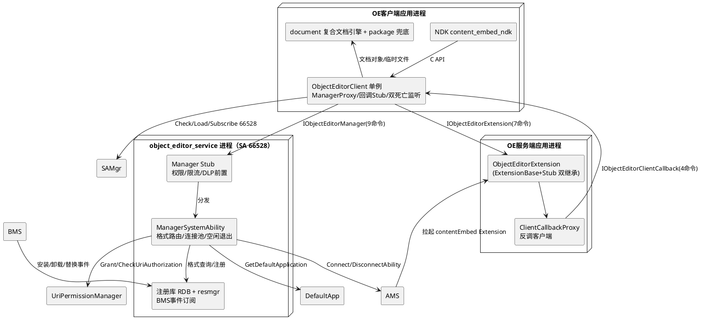

# 业务背景

本文按当前代码说明对象编辑部件 object_editor（Content Embed Kit 的系统实现）。阅读顺序：[术语](glossary.md) → [架构](architecture.md) → [业务背景](本文)；修改实现前查阅[编码铁律](coding-standards.md)。

## 应用定位

### 核心职责

object_editor 是 OpenHarmony 标准系统的应用间文档嵌入与协同编辑部件：OE 客户端应用把外部文档嵌进自己的宿主文档；OE 服务端应用通过注册 OE Extension 声明支持的格式；系统服务层（SA 66528）在两者之间完成注册管理、按格式路由、按需拉起、URI 授权与生命周期回收。

| 业务能力 | 主要职责 | 实现入口 |
|---|---|---|
| 对外 C API | 客户端/服务端应用的全部 NDK 接口（代理、文档、存储、流、Extension 回调） | `frameworks/ndk/src/*_capi.cpp`，头文件 `interfaces/kits/c/` |
| 会话建立与停止 | StartWork/StopWork：准备沙箱临时文件、取 SA 代理、传回调 binder、挂死亡监听 | `client/src/object_editor_client.cpp`、`frameworks/ndk/src/object_editor_proxy_capi.cpp` |
| 注册管理 | 解析 `content_embed_config` 入库、BMS 事件增删改、资源按 locale 还原 | `database/src/object_editor_manager_database.cpp`、`*_resmgr.cpp`、`*_utils.cpp` |
| 格式路由与拉起 | 按后缀/OEID 选目标应用（默认应用策略→最新注册策略→diversion 改道→通用包兜底），AMS 连接，URI 授权 | `system_ability/src/object_editor_manager_system_ability.cpp` |
| OE 文档引擎 | MS-CFB 复合文件读写、storage/stream 层次、OEID 落在根目录项 CLSID、碎片回收重建 | `document/src/storage.cpp`、`dirtree.cpp`、`object_editor_document.cpp` |
| Extension 运行时框架 | contentEmbed（type 511）Extension 的加载、上下文、回调注册、反向通知客户端 | `frameworks/kits/extension/src/object_editor_extension*.cpp`、`extension_ability/src/` |
| 通用包兜底 | 无注册格式时以应用图标嵌入、inotify 监听编辑回流、唤起默认应用编辑 | `package/src/object_editor_package.cpp`、`package_data.cpp`、`file_watcher.cpp` |
| 生命周期回收 | Extension 20s 空闲停用、SA 600s 空闲自卸载、客户端死亡清理、停止原因登记（60s 窗口） | `object_editor_connection.cpp`、`object_editor_manager_system_ability.cpp`、`object_editor_client_death_recipient.cpp` |

组件适用系统在 `bundle.json` 的 `adapted_system_type` 声明为 standard；依赖 27 个 OH 组件（samgr/ipc/safwk/ability_runtime/bundle_framework/relational_store/resource_management/image_framework/dlp_permission_service 等）。

### 职责边界（本组件不负责）

- 不实现 OE 服务端应用的文档编辑逻辑；编辑、快照生成、能力声明全部由三方应用回调实现，本仓只做框架与通道。
- 不实现复合文档格式规范之外的内容语义；`document/` 只提供 CFB 结构读写，不理解业务流内容。
- 不决定“某格式该用哪个应用打开”的最终策略；默认应用查询委托 `IDefaultApp`，本仓只实现候选内的选择顺序。
- 不做 DLP 策略本身；DLP 沙箱拦截是 fail-closed 的准入判断，策略与判定在 `dlp_permission_service`。
- 不替代 IPC/SELinux/init/账号基础设施；SA 以 `object_editor_service` UID、`system_basic` APL、`bindercall` 按需拉起方式接入这些边界。
- 不保证崩溃自愈；`auto-restart=false`，进程异常退出后依赖客户端下一次 `LoadSystemAbility` 重新拉起（等待上限 `LOAD_TIMEOUT_MS=5000`）。

## 系统上下文

图中三块进程边界即三条 IPC 通道（见[术语表](glossary.md)）；package 通用包兜底只在客户端进程内运行，无 Extension 进程参与。所有跨进程回调均为 `TF_SYNC`——extension 调用线程会阻塞到客户端回调返回。

## 核心输入

1. NDK C API 调用：客户端代理生命周期（Create/Destroy/Start/Stop）、文档/存储/流操作、格式与信息查询、Extension 回调注册与反向通知。
2. SA 侧 IPC 请求：接口令牌 + Parcelable 文档（8 字段：oeid、isLinking、四个 file URI、operateType、documentId）+ 客户端回调 binder + 调用方 tokenId。
3. BMS 公共事件：PACKAGE_ADDED/REMOVED/FULLY_REMOVED/REPLACED/CHANGED 与 USER_SWITCHED（App Clone 的 `appIndex>0` 与跨用户事件被过滤）。
4. OE 服务端应用包内 `resources/base/profile/content_embed_config.json`（oeid、file_exts、name、icon、description）。
5. 预置配置 `etc/diversion_map.json`（Windows OLE CLSID → 本地 OEID 改道表，进程构造期读取一次）。
6. 系统状态：锁屏/解锁公共事件（影响 Extension 空闲停用的判定节奏）、SA 注册状态变化、屏幕事件。

## 核心输出

1. 会话产物：Extension binder（客户端直连通道）、`isPackageExtension` 标志、documentId 与沙箱临时目录布局（`<TempDir>/<documentId>/{ole.bin, snapshot.png, native/}`）。
2. 客户端回调通知：OnUpdate（携带整个 Parcelable 文档）/OnError/OnStopEdit(dataModified)/OnExtensionStopped；extension 异常死亡时按停止原因决定是否打扰（`SA_CLEAN_IDLE` 静默）。
3. 快照：PNG 文件写在客户端沙箱授权路径上，客户端解码为 `OH_PixelmapNative`（所有权移交调用者）。
4. 格式查询结果：`ObjectEditorFormat`（oeid、本地化 name/description、icon PixelMap、file_exts），由 resmgr 按 locale 还原。
5. 生命周期动作：`ConnectAbilityWithIndirectCallerInfo`（携带间接调用方 tokenId/uid/pid）、`DisconnectAbility`、`StartAbility`（经 SA 的 `StartUIAbility`，want 绑定校验调用方 bundle）、`UnloadSystemAbility(66528)`。
6. 数据落盘：OE 格式文件（CFB）写入客户端沙箱 `ole.bin`/`tmpFilePath`；注册信息入 RDB；碎片超阈值时整体重建。
7. 观测信息：HiSysEvent（CREATE_DOCUMENT、REGISTER_EXTENSION、EDIT_DOCUMENT 等）、HiTrace（DoEdit）、HiLog 域 `0xD005118`。

本次知识整理未运行构建、单测或设备命令；上述行为描述以源码为准，命令与测试入口见[架构](architecture.md)“构建与测试”。
